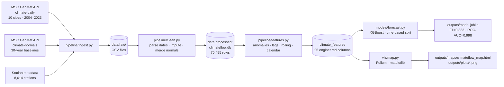

# ClimateFlow

End-to-end climate data pipeline and machine learning project using publicly available Canadian weather records. The pipeline ingests daily observations and 30-year climate normals from Environment and Climate Change Canada's MSC GeoMet API, engineers geospatial and temporal features, trains an XGBoost classifier to predict extreme weather days, and produces an interactive Folium map alongside diagnostic visualizations. Built to demonstrate pipeline engineering, multi-source data integration, geospatial analysis, and applied ML on real-world environmental data.

---

## Results

XGBoost classifier predicting extreme temperature days (test period 2020–2023, trained on 2004–2019).

| City | Test days | Extreme days | F1 | Precision | Recall | ROC-AUC |
|---|---|---|---|---|---|---|
| Vancouver | 1,456 | 68 | 0.927 | 0.927 | 0.927 | 0.999 |
| Calgary | 1,461 | 76 | 0.878 | 0.818 | 0.947 | 0.998 |
| Edmonton | 1,429 | 69 | 0.825 | 0.725 | 0.957 | 0.998 |
| Saskatoon | 1,454 | 72 | 0.814 | 0.716 | 0.944 | 0.997 |
| Winnipeg | 1,456 | 37 | 0.892 | 0.804 | 1.000 | 1.000 |
| Toronto | 1,461 | 20 | 0.691 | 0.543 | 0.950 | 0.999 |
| Ottawa | 1,387 | 25 | 0.807 | 0.676 | 1.000 | 1.000 |
| Montréal | 1,458 | 20 | 0.947 | 1.000 | 0.900 | 0.999 |
| Québec City | 1,181 | 24 | 0.906 | 0.828 | 1.000 | 1.000 |
| **Overall** | **12,283** | **411** | **0.833** | **0.782** | **0.961** | **0.998** |

An extreme day is defined as any day where MAX_TEMPERATURE or MIN_TEMPERATURE falls beyond ±2σ of that city's training-period mean — a city-specific, data-driven threshold rather than a fixed national cutoff.

---

## Pipeline



---

## Project Structure

```
climateflow/
├── pipeline/
│   ├── ingest.py          # Step 1 — fetch from MSC GeoMet OGC API
│   ├── clean.py           # Step 2 — parse, impute, merge normals
│   └── features.py        # Step 3 — engineer 25 model-ready features
├── models/
│   └── forecast.py        # Step 4 — XGBoost classifier + ablation
├── viz/
│   ├── map.py             # Step 5 — interactive Folium map + plots
│   ├── eda.py             # Exploratory plots (missingness, distributions)
│   ├── extreme_variance.py  # Diagnostic: warm vs cold extreme asymmetry
│   └── temperature_kde.py   # KDE distributions per city with tail shading
├── tests/
│   ├── test_clean.py
│   └── test_features.py
├── data/
│   ├── raw/               # Downloaded CSVs (not committed)
│   └── processed/         # climateflow.db + feature CSV (not committed)
├── outputs/
│   ├── maps/              # climateflow_map.html
│   ├── plots/             # PNG visualizations
│   ├── model.joblib       # Serialized XGBoost model
│   └── metrics_by_city.csv
└── requirements.txt
```

---

## Data Sources

All data is fetched programmatically via Canada's [MSC GeoMet OGC API](https://api.weather.gc.ca/collections) — no manual downloads required.

| Dataset | Endpoint | Coverage |
|---|---|---|
| Daily climate observations | `climate-daily` | 10 cities, 2004–2023, ~70,500 rows |
| Climate normals | `climate-normals` | 30-year baselines (1981–2010), 10 cities × 12 months |
| Station metadata | `climate-stations` | 8,614 stations across Canada |

**Selected cities:** Vancouver · Calgary · Edmonton · Saskatoon · Winnipeg · Toronto · Ottawa · Montréal · Québec City

---

## Setup

### 1. Create the environment

```bash
conda create -n geoflow python=3.11 -y
conda activate geoflow
pip install -r requirements.txt
```

### 2. Run the pipeline

Each step reads from the previous step's output. Run them in order from the project root:

```bash
python -m pipeline.ingest    # ~5 min — fetches data from the API
python -m pipeline.clean     # ~10 sec — cleans and saves to SQLite
python -m pipeline.features  # ~15 sec — engineers features
python -m models.forecast    # ~30 sec — trains model, saves outputs
python -m viz.map            # ~20 sec — generates map and plots
```

### 3. View outputs

| Output | Path |
|---|---|
| Interactive map | `outputs/maps/climateflow_map.html` — open in any browser |
| Model metrics | `outputs/metrics_by_city.csv` |
| Plots | `outputs/plots/*.png` |
| Trained model | `outputs/model.joblib` |

### 4. Run tests

```bash
pytest tests/
```

---

## Engineered Features

| Feature | Description |
|---|---|
| `temp_relative` | Daily mean temperature minus 30-year normal for that city × month |
| `temp_max_relative` / `temp_min_relative` | MAX/MIN anomaly vs normal |
| `precip_relative` | Daily precipitation minus daily normal (monthly normal ÷ days in month) |
| `temp_lag_1/2/3` | Mean temperature on the preceding 1, 2, 3 days |
| `temp_roll_5/7` | 5- and 7-day rolling mean temperature |
| `precip_roll_7` | 7-day rolling precipitation total |
| `temp_range` | MAX − MIN temperature (daily thermal amplitude) |
| `snow_present` | Binary: snow on ground that day |
| `day_of_year` / `month` / `season` | Calendar position features |
| `rainy_season` | Binary: month falls within that city's climatological wet season |

---

## Key Design Decisions

**City-specific thresholds.** Extreme days are defined relative to each city's own distribution (±2σ of training-period MAX/MIN temperatures) rather than a single national threshold. A −20°C day is extreme in Vancouver but not in Winnipeg.

**Time-based train/test split.** The model trains on 2004–2019 and is evaluated on 2020–2023 — a forward-looking split that prevents data leakage and simulates real operational use.

**Season retained after ablation.** An ablation test confirmed that removing the `season` feature hurt F1, precision, recall, and ROC-AUC simultaneously. It was kept.

**Why more cold extreme days than warm?** Canadian MIN temperatures are more negatively skewed than MAX temperatures — Arctic air masses produce sharp, episodic cold snaps that push MIN below the −2σ fence more often than summer heat pushes MAX above the +2σ fence. Vancouver (oceanic climate) is the exception: its near-symmetric distributions produce roughly equal warm and cold extreme counts.

---

## Technologies

Python · pandas · NumPy · XGBoost · scikit-learn · GeoPandas · Folium · Matplotlib · SciPy · SQLite · MSC GeoMet OGC API
