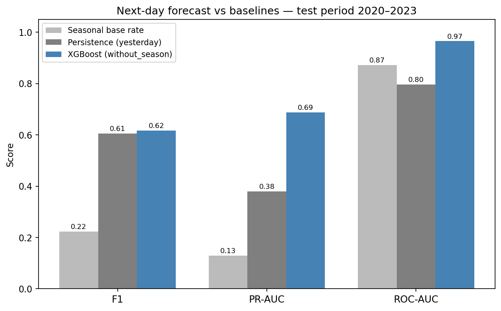
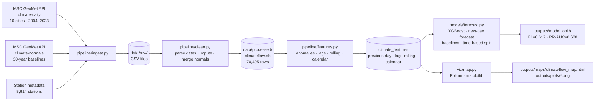

# ClimateFlow

End-to-end climate data pipeline and machine learning project using publicly available Canadian weather records. The pipeline ingests daily observations and 30-year climate normals from Environment and Climate Change Canada's MSC GeoMet API, engineers geospatial and temporal features, trains an XGBoost classifier to forecast whether tomorrow will be an extreme temperature day, and produces an interactive Folium map alongside diagnostic visualizations. Built to demonstrate pipeline engineering, multi-source data integration, geospatial analysis, and applied ML on real-world environmental data.

---

## Results

**Task: next-day forecast.** For each city and day $t$, the model predicts whether day $t$ will be an extreme temperature day using only what is known at the end of day $t-1$. It trains on 2004–2019 and is tested on 2020–2023.

### Model vs baselines (test period 2020–2023, 12,743 days, 411 extreme)

| Method | F1 | Precision | Recall | ROC-AUC | PR-AUC |
|---|---|---|---|---|---|
| Seasonal base rate | 0.224 | 0.144 | 0.499 | 0.873 | 0.129 |
| Persistence ("today is extreme if yesterday was") | 0.606 | 0.606 | 0.606 | 0.796 | 0.380 |
| **XGBoost** | **0.617** | **0.580** | **0.659** | **0.966** | **0.688** |



How to read this:

- **Persistence is a strong baseline.** Cold snaps and heat waves last several days, so yesterday's label alone reaches F1 = 0.61. At its chosen threshold, the model only slightly improves on that (F1 0.617).
- **The model ranks risk much better than either baseline.** Its PR-AUC is 0.69, against 0.38 for persistence and 0.13 for the seasonal base rate. It produces a graded probability, so its threshold can be moved toward fewer false alarms or fewer missed events. Persistence gives only a yes/no answer.
- **ROC-AUC looks high for every method** because about 97% of days are normal and easy to rank. PR-AUC is the more informative score for a rare event.

### Per city (XGBoost)

| City | Test days | Extreme days | F1 | Precision | Recall | ROC-AUC | PR-AUC |
|---|---|---|---|---|---|---|---|
| Vancouver | 1,456 | 68 | 0.450 | 0.475 | 0.426 | 0.929 | 0.442 |
| Calgary | 1,461 | 76 | 0.752 | 0.767 | 0.737 | 0.967 | 0.822 |
| Edmonton | 1,429 | 69 | 0.766 | 0.694 | 0.855 | 0.972 | 0.838 |
| Saskatoon | 1,454 | 72 | 0.717 | 0.655 | 0.792 | 0.968 | 0.778 |
| Winnipeg | 1,456 | 37 | 0.611 | 0.500 | 0.784 | 0.987 | 0.735 |
| Toronto | 1,461 | 20 | 0.367 | 0.310 | 0.450 | 0.955 | 0.381 |
| Ottawa | 1,387 | 25 | 0.407 | 0.379 | 0.440 | 0.964 | 0.456 |
| Montréal | 1,458 | 20 | 0.455 | 0.417 | 0.500 | 0.981 | 0.460 |
| Québec City | 1,181 | 24 | 0.489 | 0.524 | 0.458 | 0.983 | 0.626 |

The Prairie cities (Calgary, Edmonton, Saskatoon) score highest. They have the most extreme days, and those days come mostly in multi-day Arctic cold spells that are visible a day ahead. Eastern cities have only 20–25 extreme days in four years, so their scores are both lower and noisy.

### Definitions

**Target.** Day $t$ in city $c$ is extreme when

$$y_{c,t} = \mathbb{1}\left[T^{\max}_{c,t} > U_c \;\lor\; T^{\min}_{c,t} < L_c\right], \qquad U_c = \mu^{\max}_c + 2\sigma^{\max}_c, \qquad L_c = \mu^{\min}_c - 2\sigma^{\min}_c$$

where $T^{\max}_{c,t}$ and $T^{\min}_{c,t}$ are the observed daily maximum and minimum temperatures (°C), $\mu^{\max}_c, \sigma^{\max}_c$ are the mean and standard deviation of $T^{\max}_c$ over the training years 2004–2019, $\mu^{\min}_c, \sigma^{\min}_c$ the same for $T^{\min}_c$, and $\mathbb{1}[\cdot]$ is 1 when the condition holds and 0 otherwise. $U_c$ is the warm limit and $L_c$ the cold limit.

**Decision threshold.** The model outputs a probability $\hat p_{c,t}$ and flags a day when $\hat p_{c,t} \ge \tau$. The threshold $\tau$ is the value in $\{0.05, 0.06, \dots, 0.95\}$ that maximises F1 for a model fitted on 2004–2016 and scored on the validation years 2017–2019. The final model is then refitted on all of 2004–2019. The test years are not used to choose $\tau$ or the feature set.

**Baselines.**
- Persistence: $\hat y_{c,t} = y_{c,t-1}$, with a missing $y_{c,t-1}$ treated as 0.
- Seasonal base rate: the score is $s_{c,t} = r_{c,m(t)}$, the share of extreme days in city $c$ and calendar month $m(t)$ during 2004–2019. A day is flagged when $s_{c,t} \ge \kappa$, where $\kappa$ is the cut-off that maximises F1 on the training years.

**Metrics.** With $TP$, $FP$, $FN$ the counts of true positives, false positives and false negatives:

$$\text{Precision} = \frac{TP}{TP + FP}, \qquad \text{Recall} = \frac{TP}{TP + FN}, \qquad F_1 = \frac{2 \cdot \text{Precision} \cdot \text{Recall}}{\text{Precision} + \text{Recall}}$$

$$\text{PR-AUC} = \sum_{n} (R_n - R_{n-1})\, P_n$$

Here $P_n$ and $R_n$ are the precision and recall when days are flagged down to the $n$-th highest score; this is the average precision computed by scikit-learn. ROC-AUC is the probability that a randomly chosen extreme day gets a higher score than a randomly chosen normal day. For a binary predictor like persistence, both areas are computed from its single operating point.

---

## Pipeline



---

## Project Structure

```
climateflow/
├── pipeline/
│   ├── ingest.py          # Step 1 — fetch from MSC GeoMet OGC API
│   ├── clean.py           # Step 2 — parse, impute, merge normals
│   └── features.py        # Step 3 — engineer next-day forecast features
├── models/
│   └── forecast.py        # Step 4 — XGBoost classifier, baselines, ablation
├── viz/
│   ├── map.py             # Step 5 — interactive Folium map + plots
│   ├── eda.py             # Exploratory plots (missingness, distributions)
│   ├── extreme_variance.py  # Diagnostic: warm vs cold extreme asymmetry
│   └── temperature_kde.py   # KDE distributions per city with tail shading
├── tests/
│   ├── test_clean.py
│   └── test_features.py
├── data/
│   ├── raw/               # Downloaded CSVs (not committed)
│   └── processed/         # climateflow.db + feature CSV (not committed)
├── outputs/
│   ├── maps/              # climateflow_map.html
│   ├── plots/             # PNG visualizations
│   ├── model.joblib       # Serialized XGBoost model + decision threshold
│   ├── ablation_results.csv  # Baselines and feature sets, overall test metrics
│   └── metrics_by_city.csv
├── LICENSE
└── requirements.txt
```

---

## Data Sources

All data is fetched programmatically via Canada's [MSC GeoMet OGC API](https://api.weather.gc.ca/collections) — no manual downloads required.

| Dataset | Endpoint | Coverage |
|---|---|---|
| Daily climate observations | `climate-daily` | 10 cities, 2004–2023, ~70,500 rows |
| Climate normals | `climate-normals` | 30-year baselines (1981–2010), 10 cities × 12 months |
| Station metadata | `climate-stations` | 8,614 stations across Canada |

**Selected cities:** Vancouver · Calgary · Edmonton · Saskatoon · Winnipeg · Toronto · Ottawa · Montréal · Québec City

---

## Setup

### 1. Create the environment

```bash
conda create -n geoflow python=3.11 -y
conda activate geoflow
pip install -r requirements.txt
```

### 2. Run the pipeline

Each step reads from the previous step's output. Run them in order from the project root:

```bash
python -m pipeline.ingest    # ~5 min — fetches data from the API
python -m pipeline.clean     # ~10 sec — cleans and saves to SQLite
python -m pipeline.features  # ~15 sec — engineers features
python -m models.forecast    # ~30 sec — trains model, saves outputs
python -m viz.map            # ~20 sec — generates map and plots
```

### 3. View outputs

| Output | Path |
|---|---|
| Interactive map | `outputs/maps/climateflow_map.html` — open in any browser |
| Model metrics | `outputs/metrics_by_city.csv`, `outputs/ablation_results.csv` |
| Plots | `outputs/plots/*.png` |
| Trained model | `outputs/model.joblib` |

### 4. Run tests

```bash
pytest tests/
```

---

## Engineered Features

All observation-based features end on day $t-1$. Calendar features describe day $t$; they are known in advance.

| Feature | Description |
|---|---|
| `prev_temp_relative` | Yesterday's mean temperature minus the 30-year normal for that city × month |
| `prev_temp_max_relative` / `prev_temp_min_relative` | Yesterday's MAX / MIN temperature anomaly vs normal |
| `prev_precip_relative` | Yesterday's precipitation minus the daily normal (monthly normal ÷ days in month) |
| `prev_temp_range` | Yesterday's MAX − MIN temperature |
| `prev_snow_present` | Binary: snow on the ground yesterday |
| `temp_lag_1/2/3` | Mean temperature 1, 2 and 3 days earlier |
| `temp_roll_5/7` | Mean temperature over the 5 and 7 days ending yesterday |
| `precip_roll_7` | Total precipitation over the 7 days ending yesterday |
| `day_of_year` / `month` / `season` | Calendar position of day $t$ |
| `rainy_season` | Binary: day $t$'s month falls within that city's climatological wet season (from normals only) |

The anomaly features are defined as $\Delta_{c,t-1} = T_{c,t-1} - N_{c,m(t-1)}$, where $T_{c,t-1}$ is yesterday's observed value, $N_{c,m}$ is the 1981–2010 climate normal for city $c$ and month $m$, and $m(t-1)$ is the month of day $t-1$.

`climate_features` also stores the same-day versions (`temp_relative`, `temp_range`, …) for exploratory analysis. They are not model inputs: they are computed from the same temperatures that define the target.

---

## Key Design Decisions

**Next-day forecasting, not same-day classification.** An extreme day is defined from that day's own MAX and MIN temperatures. A model given those same-day temperatures would only re-apply the threshold rule. Every weather-based input is therefore shifted to end on day $t-1$. `tests/test_features.py::TestForecastInputsExcludeDayT` changes one day's observed weather and checks that none of the model inputs for that day change, so this cannot quietly come back.

**Missing days stay missing.** Lags, rolling windows and previous-day features are computed on a full daily calendar per city before missing station days are dropped. A day that follows a gap gets NaN for "yesterday", not the value of an older day.

**City-specific thresholds.** Extreme days are defined relative to each city's own distribution (±2σ of training-period MAX/MIN temperatures) rather than a single national threshold. A −20°C day is extreme in Vancouver but not in Winnipeg.

**Time-based split with a validation window.** The model trains on 2004–2019 and is evaluated on 2020–2023. The decision threshold and the winning feature set are chosen on 2017–2019, so the test years are used only for final scores.

**Baselines.** Persistence and the seasonal base rate show how much the model adds beyond "extremes come in runs" and "January is cold". On F1 it adds little over persistence; its gain is in ranking (PR-AUC).

**Season and rainy-season ablation.** Adding or removing `season` and `rainy_season` changes validation F1 by less than 0.01. That is within noise, so neither feature makes a meaningful difference. The saved model uses the set with the highest validation F1 (`without_season`).

**Known limitation: imputed labels.** `pipeline/clean.py` forward-fills temperature gaps of up to 7 days. On those days, both the features and the target repeat an earlier day's values, which can flatter persistence and the model slightly.

**Why more cold extreme days than warm?** Canadian MIN temperatures are more negatively skewed than MAX temperatures — Arctic air masses produce sharp, episodic cold snaps that push MIN below the −2σ fence more often than summer heat pushes MAX above the +2σ fence. Vancouver (oceanic climate) is the exception: its near-symmetric distributions produce roughly equal warm and cold extreme counts.

---

## Technologies

Python · pandas · NumPy · XGBoost · scikit-learn · GeoPandas · Folium · Matplotlib · SciPy · SQLite · MSC GeoMet OGC API

---

## License

MIT — see [LICENSE](LICENSE).
